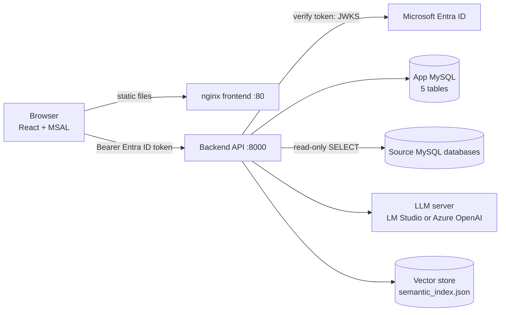
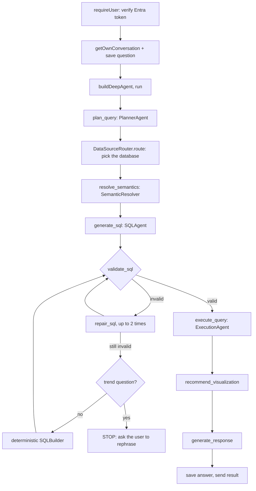

# Architecture

Backend of Autonomous Analytics (Node 22, TypeScript, Express). This document explains how the code is
organised and how a question becomes a SQL result. It was written by reading the code in this folder
(2026-10-21); nothing here was taken from older documentation. For deployment and operations see
`system overview.MD` and `autonomous_analytics_runbook.html`.

## 1. Components

| Component | Role |
|---|---|
| Frontend | React + Vite build served by nginx. Signs the user in with Microsoft Entra ID (MSAL) and calls the backend directly. |
| Backend | Express API plus the question pipeline (the "DeepAgent"). The only component that reaches databases, the LLM server and the vector store. |
| App MySQL | Application state: connections, semantic model versions, conversations, messages, pinned widgets. |
| Source MySQL databases | The business data being queried. Registered at runtime as rows in `connections`; the password is encrypted with `SECRET_KEY`. |
| LLM server | Chat models (four roles) and an embeddings model. LM Studio by default, or Azure OpenAI (`LLM_PROVIDER`). |
| Vector store | One JSON file with embeddings of the semantic model, searched by cosine similarity. |

## 2. Code layout (`src/`)

| Path | Responsibility |
|---|---|
| `index.ts` | Entry point: settings, logging, `initDb()`, listen, background index repair, graceful shutdown. |
| `app.ts` | Builds the Express app: CORS (only `FRONTEND_URL`), JSON body (10 MB), `/api/health`, `requireUser`, routers, error handler. |
| `api/routes/` | `chat`, `connections`, `semanticModel`, `kpis`, `metrics`, `dashboard`, `logs`, `health`. `api/dependencies.ts` builds shared singletons (repositories, models, vector store). |
| `agents/` | One module per pipeline stage plus the orchestrator: `deepAgent`, `plannerAgent`, `dataSourceRouter`, `semanticAgent`, `sqlAgent`, `sqlRepairAgent`, `executionAgent`, `visualizationAgent`, `responseAgent`, `ragAgent`, `queryShapeAgent` (helper functions for the planner). |
| `services/semantic/` | `parser` (loads a model), `validator`, `resolver` (matches the question to KPIs, metrics, measures, dimensions), `generator` (drafts a model from a database schema with the LLM). |
| `services/sql/` | `generator` (deterministic SQL builder), `validator` (AST rules), `sanitizer` (read-only checks, row limit), `mysqlSyntax` (date helpers). |
| `services/rag/` | `indexer` (model to documents), `embeddings`, `retriever` (search), `vectorStore` (JSON file). |
| `services/llm/` | OpenAI-compatible client factories (one per model role) and `generateStructured()`, which asks for JSON and validates it with Zod. |
| `services/datasource/` | `base`, `mysqlDataSource`, `factory`, `registry` (decrypts the connection password just in time and closes connections after each request). |
| `services/visualization/` | `recommender`: chart choice from the shape of the result. |
| `repositories/` | Database access: `db` (pool and table creation), `connection`, `semantic`, `conversation`, `kpi`, `metric`, `pinnedWidget`. |
| `schemas/` | Zod schemas and types that define the contracts between layers (`semantic`, `planner`, `agent`, `chat`, `sql`, `visualization`, ...). |
| `core/` | `config` (all settings), `auth` (Entra token check), `security` (encrypt/decrypt secrets), `logging`, `exceptions`. |
| `prompts/` | The system prompts as text files (`planner`, `sql`, `sql_repair`, `response`, `visualization`, `semantic`). They are copied to `dist/prompts` by `npm run build`. |

## 3. Question pipeline

`POST /api/chat` and `POST /api/chat/stream` run the same code. The stream version sends a `progress`
event after each step and a final `result` event (Server-Sent Events).

### Orchestrator

`agents/deepAgent.ts` runs a loop in which a tool-calling model selects the next tool. The code
decides which tool is allowed next (`plan_query`, `resolve_semantics`, `generate_sql`, `validate_sql`
or `repair_sql`, `execute_query`, `recommend_visualization`, `generate_response`) and rejects calls out
of order. Limits in the code: 3 attempts per tool, 6 out-of-order calls, 8 nudges to the model. A
result that starts with `STOP:` ends the run and its message is shown to the user.

### Stages

| Stage | What it does | Calls |
|---|---|---|
| Planner (`plannerAgent.ts`) | One LLM call returns intent, subject, analysis pattern, dimensions, filters, time phrase and granularity, ranking. Code then corrects it: dimensions must appear in the question, the period is parsed from the question's own words and turned into a date range, bucket words set the granularity. It also builds `measure_text`, the question's wording with periods, groupings and filler removed. | planner model |
| Router (`dataSourceRouter.ts`) | Ranks every published model against the question by similarity and picks one data source. When scores are too close it asks the LLM to choose. | vector store, embeddings, app DB |
| Resolver (`services/semantic/resolver.ts`) | Matches the subject to a KPI, metric or measure, each dimension and filter field to a dimension, and the period to a date dimension. See section 4. | vector store, embeddings |
| SQL agent (`sqlAgent.ts`) | Builds a grounding context (tables, columns, joins, KPI filters, required SELECT, WHERE and GROUP BY items) and asks the LLM for one SELECT. | SQL model |
| Validator (`services/sql/validator.ts`) | Parses the SQL into an AST and applies the rules in section 5. | none |
| Repair (`sqlRepairAgent.ts`) | Gives the LLM the validation errors and asks for a fixed query. At most `MAX_SQL_REPAIR_ATTEMPTS` (2). | SQL model |
| Execution (`executionAgent.ts`) | Connects to the source database, runs the query with a row cap and a timeout. | source database |
| Visualization (`visualizationAgent.ts`, `recommender.ts`) | Profiles the result columns in code, lets the LLM choose a chart, and keeps only choices that point at real columns. | chat model |
| Response (`responseAgent.ts`) | Writes the summary and insights from the returned rows. | chat model |

## 4. Semantic layer

The semantic model is data, stored as JSON in `semantic_model_versions`. It is what grounds every
question, so a wrong or vague model produces wrong answers.

| Object | Meaning |
|---|---|
| Entity | A table: name, `table_name`, primary keys, dimensions, measures. |
| Dimension | A column to group or filter by. A dimension can carry a `reference` (target entity and key); this is how joins are known. |
| Measure | An aggregation of a column: `count`, `count_distinct`, `sum`, `avg`, `min`, `max`. |
| Metric | A named measure, optionally with filters. |
| KPI | A named business definition: a formula (a metric), default filter logic (AND/OR groups of conditions, including `reference_condition` for EXISTS / NOT EXISTS across entities), required grouping, supported dimensions. |

**Versions.** Per data source there is at most one `draft` and one `published` row. Saving edits
overwrites the draft. Publishing makes the draft the only row, which deletes the previous published
one. There is no rollback.

**Index.** `services/rag/indexer.ts` turns every entity, dimension, measure, metric and KPI into one
text document. The text is `KPI: <name>. <description> Formula: <formula>.` for KPIs and
`Metric: <name>. <description> Base measure: <measure>.` for metrics, so descriptions directly affect
matching. Documents are embedded and stored in the vector file. The index is rebuilt on publish and
healed at startup for models that have none.

### Choosing the KPI, metric or measure (`resolvePlan`, `resolvePrimaryMeasure`)

The same question can match a KPI (which carries the business filters), the metric under it (which
does not) and a bare measure. Choosing the metric silently drops the KPI's filters, so the code is
built to prefer the KPI:

1. The catalogue is searched with the planner's subject and with `measure_text`, keeping the better
   score per item. When `measure_text` contains every word of the subject it is searched alone.
2. A KPI whose name equals `measure_text` exactly is chosen outright.
3. Otherwise the top KPI is used if it beats the best metric by `KPI_STRONG_MARGIN` (0.05), or if its
   score is at least `KPI_MIN_SCORE` (0.52) and not more than 0.05 below the best metric
   (`KPI_PREFERENCE_MARGIN`, default -0.05, settable by environment variable).
4. If a metric still wins and an enabled KPI wraps it (`metric_ids`), that KPI is used instead
   (`kpiWrappingMetric`). With several wrappers the best-scoring one among the search hits wins.
5. Only then is a bare metric or measure used.

Every selection is logged as `primary_measure_selected` with the scores involved.

## 5. SQL generation and safety

* **Generation.** The LLM writes the SQL from the grounding context. `services/sql/generator.ts`
  (`SQLBuilder`) is a deterministic compiler for the same resolution. It is the fallback when repairs
  fail, and a way to test the model without an LLM.
* **Validation rules** (`services/sql/validator.ts`): a single statement; read-only SELECT only; no
  forbidden keywords; valid syntax; every table and column exists in the semantic model; join
  conditions follow model references; every entity the resolution needs is joined; no unused joins;
  valid window specifications; requested breakdown dimensions appear in SELECT and GROUP BY; a LIMIT
  within `MAX_QUERY_ROWS` is added when missing.
* **Execution limits.** `MAX_QUERY_ROWS` (1000) and `QUERY_TIMEOUT_SECONDS` (30).
* **Secrets.** Source database passwords are stored encrypted (`core/security.ts`) and decrypted only
  when a connection is opened. They are never returned to a client.

## 6. Data stores

| Store | Content |
|---|---|
| `connections` | Source databases: host, port, database, user, encrypted password, enabled, default. |
| `semantic_model_versions` | Model JSON per data source, with `status` (`draft` or `published`) and `version_number`. |
| `conversations`, `messages` | Chat history, owned by the signed-in user. Assistant messages hold the full response, including SQL and progress. |
| `pinned_widgets` | Charts a user pinned to the dashboard. |
| `semantic_index.json` | Embedded model documents, in `VECTOR_STORE_PATH`. |

`initDb()` creates missing tables at every start. There are no migrations.

## 7. Authentication and ownership

Every route except `GET /api/health` runs `requireUser`: the `Authorization: Bearer` token must be a
Microsoft Entra ID token for this tenant and client (signature from the tenant's published keys,
issuer, audience and expiry checked). The user is the token's `oid`. Conversations and pinned widgets
belong to that user; another user's conversation id is reported as not found. Connections, models,
KPIs and metrics are shared by all signed-in users. If `AZURE_ENTRA_TENANT_ID` or
`AZURE_ENTRA_CLIENT_ID` is missing, every protected route returns 401.

## 8. LLM roles

| Role | Setting | Used by |
|---|---|---|
| Chat | `LM_STUDIO_MODEL` | visualization, response |
| Planner | `SEMANTIC_PLANNER_MODEL` | planner, routing tie-break, semantic generation |
| Tool calling | `TOOL_CALLING_MODEL` | orchestrator |
| SQL | `SQL_AGENT_MODEL` | SQL agent, repair agent |
| Embeddings | `LM_STUDIO_EMBEDDING_MODEL` | indexer, retriever |

An empty role falls back to the chat model. With `LLM_PROVIDER=azure_openai` the `AZURE_OPENAI_*`
settings are used instead.

## 9. Extending it

* **New database:** add a connection, generate or import a semantic model for it, review the draft,
  publish. The router then considers it for every question.
* **New KPI:** add it to the model with a metric, filters and a description that uses the words people
  ask with; keep metric descriptions short and neutral so they do not compete with the KPI.
* **New relationship:** give the dimension a `reference` to the target entity and key. Use unique keys
  only; joining on a repeated name multiplies rows.
* **New pipeline stage:** add a tool in `deepAgent.ts` and its place in the ordering function.

## 10. Known limitations (observed in testing, October 2026)

* The deterministic SQL builder cannot bucket by time, so trend questions have no fallback when the
  LLM's SQL keeps failing validation.
* It joins only entities that are directly related. A path through a middle table (task, then case,
  then service center) works only when a field from the middle table is also requested.
* Its `between` filter on a datetime column stops at midnight of the last day.
* A KPI's `required_grouping_dimensions` is always added to the query, even when the question groups by
  something else.
* A planner filter on the same field as a KPI's own filter is applied in addition to it.
* The LLM sometimes writes a dimension's display name as a column in cross-table filters; the
  validator catches it and the repair loop usually fixes it, at the cost of minutes.
* The written answer can contain wrong arithmetic or ranking, because the response model computes
  them itself.
